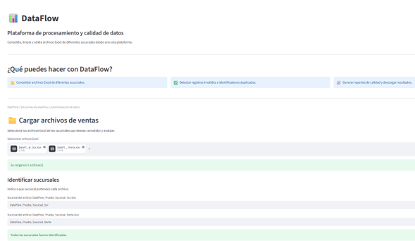
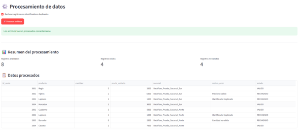
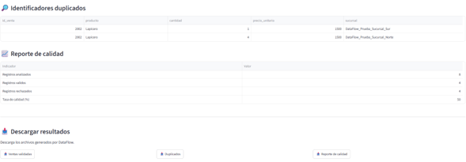
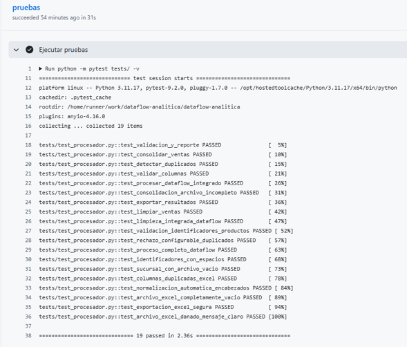

# 📊 DataFlow — Procesamiento y Calidad de Datos

**DataFlow** es una aplicación web desarrollada en Python y Streamlit para consolidar, limpiar y validar archivos Excel de ventas provenientes de diferentes sucursales.

Su objetivo es reducir tareas manuales de preparación de datos, facilitar la identificación de errores y generar reportes descargables para apoyar los procesos de análisis empresarial.

## 🚀 Funcionalidades

- **Consolidación de archivos:** permite cargar múltiples archivos Excel y reunir sus registros en un único conjunto de datos.
- **Identificación de sucursales:** permite asignar un nombre de sucursal a cada archivo.
- **Limpieza de datos:** normaliza nombres de productos y convierte cantidades y precios a valores numéricos.
- **Validación de registros:** identifica datos faltantes y valores no válidos.
- **Detección de duplicados:** identifica registros con el mismo `id_venta`.
- **Rechazo configurable:** permite marcar como rechazados los registros duplicados.
- **Indicadores de calidad:** muestra registros analizados, válidos, rechazados y una tasa de calidad en el reporte.
- **Exportaciones Excel:** permite descargar los datos validados, duplicados y reporte de calidad.
- **Manejo de errores:** informa cuando faltan columnas obligatorias o cuando un archivo Excel está dañado.

## 🛠️ Tecnologías utilizadas

- **Python:** motor de procesamiento.
- **Pandas:** limpieza, consolidación y análisis de datos.
- **Streamlit:** interfaz web.
- **OpenPyXL:** lectura y generación de archivos Excel.
- **Pytest:** pruebas automatizadas.
- **GitHub Actions:** ejecución de pruebas en el repositorio de desarrollo.

## 📁 Formato de entrada

Los archivos deben tener extensión `.xlsx` y contener estas columnas obligatorias:

| Columna | Descripción |
|---|---|
| `id_venta` | Identificador de la venta |
| `producto` | Nombre del producto |
| `cantidad` | Cantidad vendida |
| `precio_unitario` | Precio unitario del producto |

Cada archivo puede representar una sucursal diferente.

## 📥 Archivos de salida

DataFlow permite descargar tres archivos:

| Archivo | Contenido |
|---|---|
| `ventas_validadas.xlsx` | Registros procesados, estado de validación y motivos de rechazo |
| `duplicados.xlsx` | Registros identificados como duplicados |
| `reporte_calidad.xlsx` | Indicadores generales de calidad de los datos |

Los registros rechazados se conservan en el reporte de datos validados para facilitar su revisión.

## 📖 Cómo utilizar DataFlow

1. Abre la aplicación publicada en Streamlit.
2. Carga uno o varios archivos Excel compatibles.
3. Asigna un nombre a cada sucursal.
4. Decide si deseas rechazar los registros con identificadores duplicados.
5. Haz clic en **Procesar archivos**.
6. Revisa los resultados y descarga los reportes Excel.

## 🔐 Privacidad y seguridad

**Esta aplicación pública es una demostración técnica y debe utilizarse únicamente con datos ficticios o expresamente autorizados para uso público.**

No cargues datos personales, financieros confidenciales, secretos empresariales ni información sensible de clientes.

La aplicación utiliza Streamlit Community Cloud. Aunque las exportaciones se generan en memoria durante el procesamiento, esto no constituye una garantía de eliminación inmediata de todos los datos ni una certificación de seguridad del servicio de alojamiento.

Se han implementado y probado controles específicos para validar archivos, gestionar errores y evitar que determinados textos se exporten como fórmulas de Excel. Estos controles no representan una auditoría de seguridad integral.

Para utilizar DataFlow con información empresarial confidencial se requiere una evaluación adicional de privacidad, infraestructura, controles de acceso y tratamiento de datos.

## 📊 Presentación profesional del proyecto

DataFlow es un proyecto demostrativo de automatización
y calidad de datos desarrollado con Python, Pandas
y Streamlit.

La presentación incluye el problema empresarial,
la solución técnica, los resultados verificados
y las competencias profesionales demostradas.

📄 [Ver presentación de DataFlow (PDF)](portafolio/presentacion_dataflow.pdf)

**Nota:** El caso empresarial utiliza datos ficticios.

## 📸 Evidencias del proyecto

Las siguientes capturas corresponden a una simulación
empresarial realizada con datos ficticios.

### 1. Aplicación web DataFlow

### 2. Procesamiento y validación de datos

**Resultados verificados:**
- 8 registros analizados.
- 4 registros válidos.
- 4 registros rechazados.
- 2 registros con identificador duplicado.

### 3. Indicadores y reportes

**Tasa de calidad del conjunto de prueba: 50 %.**

### 4. Pruebas automatizadas

El motor de procesamiento superó 19 pruebas
automatizadas ejecutadas mediante Pytest y GitHub Actions.

## 🧪 Pruebas y calidad

El motor de desarrollo ha superado **19 pruebas automatizadas**, que incluyen comprobaciones de validación, consolidación, duplicados, exportación y manejo de archivos inválidos.

También se han realizado pruebas funcionales sobre la aplicación publicada.

La cobertura actual no garantiza la ausencia de errores en todos los escenarios posibles.

## ⚠️ Alcance y limitaciones

DataFlow está diseñado actualmente para archivos Excel de ventas que respeten la estructura requerida.

Esta versión no incluye autenticación de usuarios, almacenamiento empresarial permanente, un sistema de permisos ni análisis predictivos.

El sistema es un prototipo funcional orientado a la preparación y calidad de datos.

## 💼 Aplicaciones empresariales

DataFlow puede servir como demostración de soluciones para:

- Consolidación de reportes de ventas.
- Limpieza y estandarización de información.
- Detección de duplicados.
- Control de calidad de archivos Excel.
- Automatización de tareas repetitivas de preparación de datos.

## 📌 Estado del proyecto

**Versión:** MVP funcional en preparación comercial.

**Entorno:** aplicación demostrativa publicada mediante Streamlit Community Cloud.

**Próximas actividades:** revisión de privacidad, pruebas empresariales integrales, auditoría técnica y preparación del portafolio freelance.

---

**DataFlow — Soluciones de analítica, automatización y calidad de datos.**
